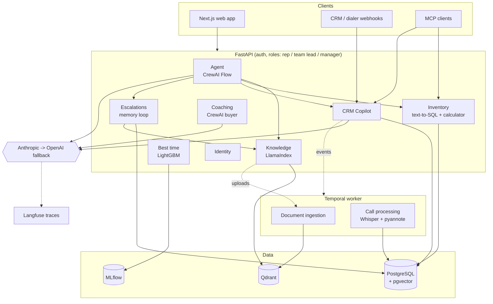
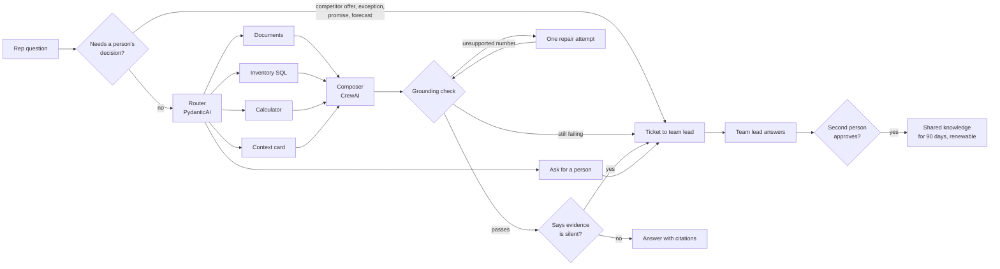

<div align="center">

# AI OS: Sales Team-Lead Copilot and CRM Copilot

**An AI copy of a real estate sales team lead: answers reps with citations, prepares them for every
call, coaches them, and hands anything risky to a human.**

[](https://github.com/Mrwanawad/AI-OS-Sales-Copilot-using-FastAPI-CrewAI-LlamaIndex-Temporal-NextJS/actions/workflows/ci.yml)


</div>

<p align="center"></p>

---

## Contents

- [The problem](#the-problem)
- [What it does](#what-it-does)
- [Architecture](#architecture)
- [How a question is answered](#how-a-question-is-answered)
- [Safety by design](#safety-by-design)
- [Tech stack](#tech-stack)
- [Methodologies](#methodologies)
- [Evaluation results](#evaluation-results)
- [Testing and quality gates](#testing-and-quality-gates)
- [Run it locally](#run-it-locally)
- [Deploy](#deploy)
- [Project structure](#project-structure)
- [Status and honest limits](#status-and-honest-limits)

All projects, units and clients in `demo_data/` are invented. Design decisions are in
[architecture.md](architecture.md); build status is in [CHECKPOINT.md](CHECKPOINT.md).

## The problem

In a real estate brokerage, new sales reps lean on team leads for everything: which payment
plan fits, whether a unit is still available, what the client said last week, how to answer
"a competitor offered me 20% off". Team leads become the bottleneck, and knowledge lives in
their heads, PDFs, price sheets and the CRM.

**AI OS** gives every rep the team lead's knowledge on demand, while keeping humans in charge of
every decision that changes money, makes a promise or touches a client's personal data.

## What it does

| Area | What a user gets |
|---|---|
| **Agent** `/agent/ask` | Routes each question to documents, live inventory SQL, the calculator, the client's context card or a person. Every number must appear in cited evidence, or the answer is withheld and escalated. English and Egyptian Arabic. |
| **Knowledge** `/knowledge/*` | Hybrid dense + sparse retrieval with cross-encoder reranking and Arabic normalization. Team leads upload brochures and price sheets; ingestion runs as a durable Temporal workflow with document versioning. |
| **Inventory** `/inventory/*` | Guarded read-only text-to-SQL over live units, plus installment, mortgage and discount calculations in exact `Decimal`. |
| **CRM Copilot** `/crm/*` | Signed CRM webhooks, Whisper transcription with consent checks, context cards before calls, handover summaries on reassignment, post-call CRM updates. |
| **Coaching** `/coaching/*` | Role-play against invented buyer personas, optional ElevenLabs voice, rubric scores that must quote the rep's own words. |
| **Best time to call** `/best-time/*` | LightGBM model on call outcomes, tuned with Optuna, tracked in MLflow, promoted only if it beats a baseline, retrained weekly. |
| **Escalations** `/escalations/*` | Ticket queue for team leads, answers back to the rep, two-person approval before an answer becomes shared knowledge, review periods with renew and revoke, signed webhook push. |
| **Privacy** `DELETE /crm/leads/{id}` | Egypt PDPL: erase a client everywhere, plus daily retention for transcripts, recordings, cards and closed tickets. |
| **MCP** `scripts/mcp_server.py` | Inventory, calculator and CRM tools over the Model Context Protocol for clients such as Claude Code. |
| **Accounts** `/auth/*` | Login, logout, token revocation, secret rotation, account lockout, manager-run user admin. |
| **Web app** `frontend/` | Next.js 16: leads, agent chat with citations, context cards, escalation queue, knowledge approvals, document uploads. |

## Architecture

A **modular monolith** built from **hexagonal (ports and adapters)** modules. One deployable, split
by business area. Each module's domain is free of frameworks and vendors, and `import-linter`
enforces the boundaries in CI.



**Framework responsibilities**

| Framework | Job |
|---|---|
| **CrewAI** | Multi-step agent work: the router flow, the answer composer crew, the role-play buyer crew. |
| **PydanticAI** | Typed single-shot tasks with schema-validated output: routing, text-to-SQL, context cards, handovers, post-call extraction, scoring. `FallbackModel` gives Anthropic -> OpenAI failover. |
| **LlamaIndex** | The retrieval layer, on top of Qdrant (primary) or PGVector (second adapter) behind one `VectorStore` port. |
| **Temporal** | Durable background pipelines: ingestion and CRM events, retried safely and keyed so redelivery is harmless. |

## How a question is answered



## Safety by design

**Answers can't invent numbers**
- Every number in an answer must appear in the cited evidence or the rep's question, with its scale ("5.2M", "3.9 million", "مليون") and as a percentage when it is one.
- One repair attempt, then the text is withheld and the question escalates.
- Prices and installments come from the database and `Decimal` code, never from model arithmetic. Live inventory beats any price in a document.

**Text-to-SQL can't touch anything it shouldn't**, three independent layers:
1. `sqlglot` guard: one `SELECT` on `units`, allowlisted columns and functions, row cap, comments stripped (74 attack and valid cases, 100% correct).
2. Read-only transaction with a statement timeout.
3. A database role with `SELECT` on `units` only. Writes fail even if the guard is bypassed.

**Humans keep the decisions**
- Competitor offers, discount exceptions, off-contract promises and price forecasts go to a team lead before any model sees them.
- Replies that only say "the documents don't mention it" escalate instead of reaching the rep.
- Shared knowledge needs a second person's approval. Phone numbers, emails and national IDs block sharing, and client-specific answers can never be shared.
- Approved answers leave search after a review period unless renewed, so a quoted price can't stay live forever.
- CRM automation never moves a lead to reserved, won or lost.

**Client data is protected (Egypt PDPL, Law 151 of 2020)**
- No recording consent, no transcription and no stored recording.
- One request erases a client from leads, interactions, cards, handovers, follow-ups, recordings and tickets.
- Daily retention clears old interaction text, recordings, dormant cards and closed tickets.
- Prompts and answers stay out of Langfuse traces by default. CrewAI telemetry is off.

**Access control**
- Signed tokens carry identity and role on every route. Names and roles in request bodies are ignored.
- Reps see only their own leads; unknown ids and other reps' leads look the same.
- scrypt password hashes, lockout after 5 failures, logout revokes the token, password resets end old sessions, secret rotation without downtime.
- CRM webhooks are HMAC-signed with a replay window.

**Prompt injection**
- Documents, transcripts and client messages are wrapped as data, not instructions.
- Tested: an invented price planted in a document can't pass the grounding check. Role-play scores above 0 must quote the rep's exact words, which limits what "give me 5 out of 5" can earn; resistance on a real model is still to be measured.

## Tech stack

| Layer | Tools |
|---|---|
| **LLMs** | Anthropic Claude (primary), OpenAI (fallback), Gemini free tier for evaluation runs only |
| **Agents** | CrewAI (Flows and Crews), PydanticAI (typed outputs, `FallbackModel`) |
| **Retrieval** | LlamaIndex, Qdrant (hybrid dense + sparse), PostgreSQL + pgvector, bge-m3 embeddings, bge-reranker-v2-m3 cross-encoder, custom BM25-style sparse encoder |
| **Arabic** | camel-tools normalization (spelling variants, Arabic digits, unit codes) |
| **Documents** | Docling (PDF and scanned docs), pandas + openpyxl + pandera (validated price sheets) |
| **Speech** | OpenAI Whisper, pyannote.audio diarization, ElevenLabs voice for role-play |
| **ML** | LightGBM, Optuna, MLflow model registry, lifelines (Kaplan-Meier survival curve) |
| **Backend** | FastAPI, Pydantic, SQLAlchemy (async), asyncpg, Alembic, sqlglot, PyJWT |
| **Workflows** | Temporal (durable ingestion and CRM event pipelines) |
| **Integration** | FastMCP servers (inventory, calculator, CRM), HMAC-signed webhooks in and out |
| **Observability** | Langfuse via OpenTelemetry GenAI spans (PydanticAI and CrewAI), MLflow |
| **Evaluation** | Custom offline gates, gold Q&A answer gate, DeepEval (optional LLM-as-judge) |
| **Frontend** | Next.js 16, React, TypeScript |
| **Quality** | pytest, ruff, import-linter, GitHub Actions |
| **Delivery** | Docker, Docker Compose, Render Blueprint, Vercel, uv |

**Deliberately not used:** LangChain and LangGraph (CrewAI covers agent work; Ragas was
dropped because it pulled them in), Celery (Temporal), LLM fine-tuning (knowledge changes daily,
RAG stays fresh and auditable), LLM arithmetic (the calculator does it), Kubernetes and Terraform
(no benefit at this size).

## Methodologies

- **Hexagonal architecture / ports and adapters** inside a **modular monolith**, with boundaries checked by `import-linter` (6 contracts).
- **Domain-driven design**: each business area owns its domain rules, ports and use cases.
- **Agentic RAG with tool routing** and **citation-first answers**.
- **Deterministic guardrails over model output**: grounding, SQL guard, non-answer and judgment detectors run as plain code, not prompts.
- **Human-in-the-loop**: escalation queue and two-person approval for shared knowledge (the memory loop).
- **Evaluation-driven development**: offline gates in CI, a gold answer gate on real models, and only real run results reported. A replay is labelled as one.
- **Defense in depth** for text-to-SQL and access control.
- **Optimistic concurrency** (status-checked and versioned updates) so simultaneous reviews or messages can't overwrite each other.
- **Idempotent, durable workflows**: event ids as Temporal workflow ids make webhook redelivery harmless.
- **Privacy by design**: consent checks, PII screening, data minimization in traces, erasure and retention.
- **Time-aware ML**: features see only earlier calls, time-based splits, baseline-beating promotion gate.
- **Test-driven safety**: every safety rule has tests that try to break it (40+ SQL attacks, injected instructions, concurrent reviews, replayed webhooks).

## Evaluation results

All cases are synthetic and run on the invented demo data, so the numbers show how the
pipeline behaves, not how it would perform for a real brokerage. Full reports are in
`evals/results/`.

**Offline checks (no LLM)**, `python scripts/run_offline_evals.py --real-models`, gated in CI:

| Check | Cases | Precision | Recall |
|---|---|---|---|
| SQL guard blocks unsafe queries | 50 attacks, 24 valid | 1.0 | 1.0 |
| Grounding check rejects unsupported numbers | 30 answers | 1.0 | 1.0 |
| Non-answer detector | 63 replies, 49 recorded from real Gemini runs | 1.0 | 1.0 |
| Judgment-question detector | 22 to escalate, 28 policy questions to leave alone | 1.0 | 1.0 |

The judgment detector was written against its own 50 cases, so 1.0 shows coverage, not how it
handles new phrasings.

**Retrieval** on 40 queries (paraphrases, typos, unit codes, Arabic, cross-lingual):

| Metric | Hashing embedder (CI) | MiniLM + TinyBERT | bge-m3 + bge-reranker-v2-m3 (production) |
|---|---|---|---|
| Recall@5 | 0.91 | 0.93 | **1.00** |
| MRR | 0.80 | 0.90 | **1.00** |
| Cross-lingual recall@5 | 0.60 | 0.40 | **1.00** |
| Typo recall@5 | 0.50 | 1.00 | **1.00** |

With only 7 demo documents the production models saturate; a real document set is needed to
tell them apart.

**Answer gate on a real model**, 40 gold cases on `gemini-3.1-flash-lite` (free tier):

| Metric | First run | After fixes |
|---|---|---|
| Pass rate | 75% | 85% |
| Routing accuracy (Arabic included) | 89% | 89% |
| Escalation recall | 29% | 57% |
| Inventory questions | 90% | 100% |

The first run found two real bugs, both fixed: "the documents don't mention it" was returned as
an answer instead of escalating, and "Is DB-210 still available?" couldn't see a sold unit.
Replaying the recorded replies through today's non-answer and judgment detectors gives 90% pass
rate and 100% escalation recall. That is a replay of the same replies, not a new model run.

**Best-time model** on 1,500 synthetic leads: AUC 0.619 against a 0.521 hour-and-weekday
baseline, top-decile lift 1.35. These measure a pattern planted in invented data; the real metric
is answer-rate uplift in a live experiment.

## Testing and quality gates

| Gate | What it covers |
|---|---|
| **510 tests** (`pytest`) | 36 unit and 19 integration suites, including real Postgres 16 + pgvector (embedded, no Docker), a real Temporal test server, in-process Qdrant and an MCP server as a subprocess. |
| **End-to-end smoke** (`scripts/smoke_e2e.py`) | 96-97 checks with real API and worker processes over HTTP: login, uploads, ingestion, search, inventory, CRM events, coaching, the memory loop. Passes on both PGVector and a Qdrant 1.20 server. |
| **Offline eval gates** | SQL guard, grounding, non-answer and judgment detectors against `evals/offline_thresholds.json`. |
| **Retrieval gate** | Recall and MRR per query tag against `evals/thresholds.json`. |
| **Migrations** | Alembic upgrade, no drift from the code, downgrade. |
| **Static checks** | `ruff check`, `ruff format`, 6 `import-linter` architecture contracts. |
| **Frontend** | `npm run build` in CI. |

## Run it locally

Python 3.12 and [uv](https://docs.astral.sh/uv/). No API keys or Docker needed for tests:

```bash
uv sync --extra agents --extra retrieval --extra ingestion --extra arabic --extra workflows --extra inventory --extra mcp --extra ml
uv run pytest                                  # 510 tests
uv run python scripts/smoke_e2e.py             # full wiring check
uv run python scripts/run_offline_evals.py --gate
```

The whole backend without Docker (embedded Postgres, Temporal dev server, API, worker, demo data):

```bash
uv run python scripts/dev_stack.py
cd frontend && npm install && npm run dev      # http://localhost:3000
```

Sign in as `rep-a`, `lead-a` or `manager-a`; the demo password is in `.devdata/demo_password`.
On Windows set `PYTHONUTF8=1`.

With Docker:

```bash
cp .env.example .env    # set AUTH_SECRET (32+ chars), CRM_WEBHOOK_SECRET and the LLM keys
POSTGRES_PASSWORD=... INVENTORY_READER_PASSWORD=... docker compose up --build
docker compose exec -e DEMO_PASSWORD=... api python scripts/seed_demo.py
```

Create the first manager with `python scripts/create_user.py <username> "<Name>" manager`.

Run the answer gate on a real model (needs a seeded database and a key):

```bash
LLM_PROVIDER=gemini GEMINI_API_KEY=... uv run python scripts/run_answer_eval.py --delay 8 --output evals/results/<name>
```

## Deploy

- **Backend:** `render.yaml` Render Blueprint: API, Temporal worker, Qdrant, Postgres, and cron jobs for weekly retraining, answer expiry, PDPL retention and token cleanup. Uploads and the promoted model live in Postgres, so services share no disk.
- **Web app:** Vercel with root directory `frontend` and `NEXT_PUBLIC_API_URL` set to the API.
- **Policy settings** to fill in before going live: discount limits (`DISCOUNT_LIMIT_*_PCT`), calling window (`CALL_WINDOW_*`), answer review period (`APPROVED_ANSWER_VALID_DAYS`) and retention periods (`*_RETENTION_DAYS`).

## Project structure

```
src/ai_os/
  bootstrap/        composition root: settings choose adapters, app and worker startup
  shared/           config, auth, files, numbers, LLM port + PydanticAI/CrewAI adapters, tracing
  modules/
    agent/          router flow, composer, grounding, non-answer and judgment detectors
    knowledge/      ingestion, chunking, hybrid retrieval, reranking, approved answers
    inventory/      SQL guard, read-only store, Decimal calculator, discount policy
    crm_copilot/    context cards, handover, post-call, transcription, privacy lifecycle
    coaching/       personas, buyer crew, verified scoring
    best_time/      features, training, serving
    escalation/     tickets, approvals, expiry, webhook notifier
    identity/       users, passwords, sessions
  workflows/        Temporal workflows and activities
  mcp_servers/      FastMCP inventory and CRM servers
frontend/           Next.js web app
evals/              gold sets, thresholds, recorded results
scripts/            dev stack, smoke test, evals, training, seeding, cron jobs, MCP entry point
migrations/         Alembic
```

Each module has `domain/` (pure rules), `ports/` (protocols), `application/` (use cases) and
`adapters/` (FastAPI routers in, vendor code out).

## Status and honest limits

Build steps 1-8 are complete; step 9 is complete except what needs paid keys or accounts.

**Not yet done:**
- Answer gate on Anthropic and OpenAI (only Gemini has been run).
- Gold sets graded by real team leads, replacing the synthetic ones.
- The brokerage's real discount, calling-hours and retention policy.
- Deployment to Render and Vercel.

**Known limits:**
- Grounding checks numbers and citations; a wrong claim with no number relies on the eval gate.
- The non-answer and judgment detectors are rule-based; new phrasings can slip past them.
- Arabic canned replies are machine-written and need a native review.
- pyannote, ElevenLabs and Whisper `large-v3` on Egyptian Arabic audio haven't run with real credentials or recordings.
- Best-time probabilities aren't calibrated, so the card shows a time, not a percentage.

---

Built by **Mrwan Awad**, AI & LLMs Engineer.
